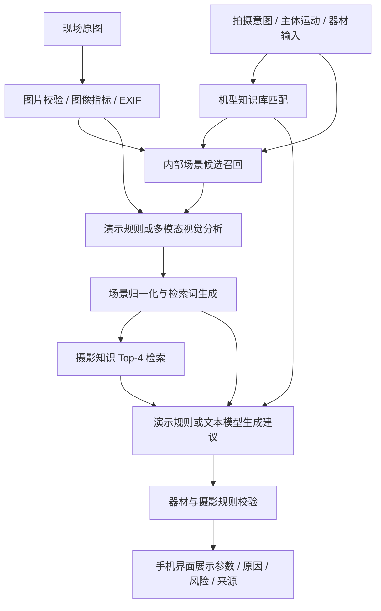

# 小栗取景参谋 📷

新增可直接体验的网页版本：`python scripts/start_web.py --demo`，访问 `http://127.0.0.1:8080/`。包含照片上传、器材与镜头联动、拍摄建议、构图参考、本机方案历史与导出；网页自动连接同站服务。阿里云 HTTPS 部署、体验码与可选 DINO 镜像见 [网页体验版与部署](docs/web-experience-deployment.md)。先在 `mobile` 执行 `npm run build`，Python 需安装 `.[mobile]`。


**面向摄影新手的相机调参助手：上传现场图，描述想要的效果，获得结合场景、摄影知识和具体机型的拍摄建议。**

这个学生项目围绕一个常见问题展开：新手知道想拍什么，却不知道怎样设置光圈、快门、ISO 和对焦。小栗尝试把“现场环境 + 拍摄意图 + 器材能力”转换成可执行、可解释、可以继续调整的拍摄方案。

当前版本为 `0.1.0`：Vue 单栏网页与 Capacitor Android 客户端共用 FastAPI 分析接口，保留原 Streamlit 摄影助手、知识工作台及视觉实验页。默认演示模式无需密钥；真实模式可配置 GLM-4.6V，Grounding DINO 为可选的本机检测器。支持同一场景一次上传1到6张照片，选择主图，综合比较主体、前景与相对距离。构图反馈先设计目标布局，再根据可见特征重绘浅色推荐分镜，展示位置、宽高占比与调整理由；原图对照单独查看。照片不能直接提供实测距离，新机位的透视与遮挡仍需现场试拍核对。

**队友开发入口：** [当前版本交接与启动说明](docs/team-handoff-20261015.md)。先运行网页演示，再按需配置模型和部署环境。

Android 第一版安装包输出到 `output/mobile/xiaoli-camera-assistant-debug.apk`（本地构建产物，不提交 Git）。电脑双击 `启动手机服务.cmd`，手机连接同一 Wi-Fi，在 App 填写电脑 IPv4 地址和手机连接令牌即可使用。App 界面本地打包，分析仍需要电脑服务；不是离线模型或实时构图控制。安装、重建、隐私与完整使用说明见 [Android App 第一版](docs/mobile-app-v1.md)。

[快速开始](#快速开始) · [当前完成情况](#当前完成情况) · [80条扩展知识与核验记录](docs/knowledge-expansion-v1.md) · [首批规则与手机接入](docs/curated-knowledge-starter.md) · [RAG检索与队友协作](docs/rag-roadmap.md) · [开发路线](#开发路线) · [创新与拓展](#创新与拓展) · [详细架构](docs/architecture.md)

<br clear="right">

## 使用流程

1. 上传现场 JPG / JPEG / PNG 原图，默认最大 15 MB。
2. 描述目标，例如“夜晚拍跑动的小狗，希望主体清晰，背景稍微虚化”。
3. 选择主体运动与手持 / 三脚架状态；在折叠设置中补充机型、画幅、焦段、最大光圈和已确认的拍摄条件。
4. 查看光圈、快门、ISO、拍摄模式、对焦、测光、白平衡及曝光补偿建议。
5. 展开查看推荐原因、现场风险、参数修正记录、场景依据和知识来源。

具体机型优先于手工选择的画幅。已知机型自动显示画幅与原生卡口，选择实际镜头后联动焦段和保守光圈起点；后端会再次校验。未知型号或自定义镜头仍保留手填入口。

## 当前完成情况

| 模块 | 已实现 | 当前边界 |
| --- | --- | --- |
| 手机应用式界面 | 原 Streamlit Web App；新增 Vue + Capacitor Android 客户端（拍照 / 选图、器材设置、建议与连接页） | Android debug 测试包需连接电脑接口；无 iOS 版，真机权限与拍照需验收 |
| 图片分析 | 文件校验、EXIF 字段提取、方向矫正、亮度 / 对比度 / 高光 / 阴影 / 清晰度指标 | 部分文件可能没有 EXIF；当前未覆盖所有厂商的嵌套 EXIF |
| 场景知识库 | 标准场景定义、规则候选召回、场景名称归一化和识别依据 | 知识库约束分类，不替代真正的视觉识别 |
| 多模态接口 | 兼容 Chat Completions 的图文请求、结构化 JSON 解析、数据模型校验 | 真实识别效果依赖所配置模型，尚未完成系统评测 |
| 摄影知识检索 | Markdown 知识库、中文字符 / 双字组合与词频评分、Top-4 检索 | 当前是关键词检索基线，未接入 Embedding 或向量数据库 |
| 受管多知识库 | 六库注册、SQLite版本与审计、严格导入、互审发布、许可与评测隔离、分库条件检索、CLI、独立导入工作台 | 默认不导入正式内容；需显式开启managed模式；审核发布仍使用CLI，尚无身份认证或图文向量检索 |
| 机型匹配 | 画幅系数、标准 ISO、保守自动 ISO 上限、快门能力、防抖说明、品牌菜单术语 | 默认型号由用户选择；未实现 EXIF 自动选型和完整镜头库 |
| 参数生成与校验 | 演示规则推荐 / 云端模型推荐，机型硬件上限、中文快门表达、运动快门及明确物理矛盾校验 | 规则只屏蔽已识别的矛盾，不能证明建议普遍正确或现场曝光合适 |
| 测试 | 页面启动、完整流程、知识检索、场景匹配、机型解析及参数校验 | 自动化测试不等同于实拍效果或识别准确率评测 |

### 两种运行模式

- **演示模式**：场景主要由用户意图、图片统计与内部规则推断；推荐由本地规则生成。适合离线演示、界面调试与回归测试。当前规则推荐器接收检索结果，但没有逐条使用资料内容推导参数。
- **云端模式**：视觉模型分析经过缩放的图像副本，文本模型结合结构化场景、机型数据和检索资料生成建议，再进行规则校验。需要配置有效的图像模型与文本模型。

当前置信度来自启发式规则或模型返回值，尚未经过统计校准，不能当作已经验证的准确率。现场照片的亮度也不等同于现场绝对照度，建议参数应结合相机测光和实拍结果微调。

### 首批机型与知识范围

手机新增首版：iPhone 15、Galaxy S24 Ultra、小米14（全球版资料）与未知型号保守指导。在主页面选择手机，可查询型号、选择原生模式和后置镜头。未做真机验证，不输出未核验的ISO／快门范围；手机建议使用受控操作指导，尚未由RAG正文推导曝光。可记录第三方App名称，但不套用原生相机控制能力；HEIC与前置相机暂不支持。
设备目录（2026-10-14）：14款相机、15款手机、12款可换镜头。网页与App按品牌/型号联动画幅、原生兼容镜头、实际焦段与等效视角；手机显示对应物理摄像头、光圈属性和已核验模式组合。新增10款相机先核验画幅/卡口，不复制其他机型曝光边界。详见[设备覆盖与联动说明](docs/device-catalog-coverage.md)。

尚未做真机验证，不输出未核验的手机ISO／快门范围；手机建议使用受控操作指导，尚未由RAG正文推导曝光。HEIC、第三方App和前置相机暂不支持。

新增17条带出处和适用条件的规则草稿，以及11个来源目录；已下载两个开放许可教材文本快照，厂商资料仅摘要。草稿不自动导入或发布，8503可下载本批ZIP。内容、授权、手机边界与复核任务见 [首批规则与手机接入说明](docs/curated-knowledge-starter.md)。

后续四批共 **121 条 JSON 知识草稿**，加上首批17条，共 **138条草稿**。其中12条修订为v2，收紧设备和拍摄条件，不增加草稿条数。卡片随附来源登记、冲突记录及核验报告；全部未审核或发布，禁止检索，不自动写入主数据库。查看 [合集与审核交接](docs/photography-knowledge-drafts.md) 或 [知识卡目录](data/knowledge_drafts/photography-20261013/upload_cards/)。

新增 [手机型号专项草稿](data/knowledge_drafts/mobile-models-20261014/README.md)：22条型号事实知识卡，覆盖27个完整型号，24项来源登记。仍为待审核草稿，禁止检索；仅提交知识文件、来源和核验材料，不自动导入主数据库或注册运行时型号。

具体机型：Canon EOS R50、Nikon Z50、Sony α6700、Fujifilm X-S20。

通用配置：全画幅、APS-C、M4/3、未知机型。机型资料的厂商链接保存在 [camera_profiles.yaml](knowledge/cameras/camera_profiles.yaml)；保守自动 ISO 上限是本项目策略，不是厂商宣称的画质阈值。

摄影知识覆盖曝光基础、人像、快速主体、风景、瀑布慢门、手持 / 三脚架夜景、食物、逆光和常见问题。场景分类与摄影文档分开维护。

### 知识库搭建与内容整理分离

新增工程底座注册 `scene`、`composition`、`style`、`technique`、`equipment`、`case` 六个空库。不自动采集资料或将已有文档判定为审核通过。默认保留旧演示模式；设定 `KNOWLEDGE_RETRIEVAL_MODE=managed` 后，只检索已发布且允许检索、条件匹配的参考资料，不混入旧目录或评测答案。

```bash
python -m camera_assistant.knowledge init
python -m camera_assistant.knowledge libraries
python -m camera_assistant.knowledge --help
```

数据库默认在 `data/knowledge.db`，不提交Git。知识库开发者的配置、实际导入格式、CLI和队友接口见 [知识库工程说明](docs/knowledge-development.md)；整理人员的范围、任务与审核清单见 [整理规范](docs/knowledge-handbook.md)。原场景与机型YAML仍由原服务使用，不会自动被新库覆盖。

### 独立知识导入工作台

在项目根目录另开一个终端运行：

```powershell
python -m streamlit run knowledge_app.py --server.address 127.0.0.1 --server.port 8503
```

访问 [小栗知识工作台](http://localhost:8503/)；原摄影助手仍使用8501。工作台无需模型密钥，支持多文件上传或粘贴JSON／YAML／带front matter的Markdown，下载模板、格式预览、确认后整批导入草稿，以及只读查看六库版本和操作日志。单文件2MiB，最多20文件／每批10MiB，一文件对应一条知识。

「先看看示例效果」只预览占位模板，不写入数据库。真实资料需点击「校验并预览」并手动勾选确认；任何文件错误都会阻止整批导入。输入变化会撤销旧预览。草稿不参与检索，仍须通过独立队员审核与发布；页面不自动开启managed模式或修改来源许可。

想先验证上传功能，可使用 [上传测试样本集](data/knowledge_samples/upload-smoke-v1/README.md)：6条正常记录覆盖六库及JSON／YAML／Markdown，另有4个错误样本、同版本冲突与v2更新样本。直接上传文件，不需要ZIP；测试数据禁止检索，不作为正式摄影知识。首次导入正常组应新增6个草稿，重复导入不会重复写入。

当前是本地可信团队工具，未实现登录鉴权，**不要直接开放公网**。上传文件仅在解析期间临时落盘并立即清理；确认后保存的是结构化知识记录，不保留上传原文件。请勿上传密钥或其他敏感数据。

## 快速开始

需要 Python 3.11 或更高版本。在项目根目录运行以下命令。

### Windows一键启动（已安装依赖后）

双击项目根目录的 [启动项目.cmd](启动项目.cmd)，默认启动当前新版网页，不再打开旧版 Streamlit 拍摄助手。

- 启动前自动执行 `npm run build`，使用当前 `mobile/src/` 源码；构建失败会停止，不打开旧构建。
- 默认访问 `http://127.0.0.1:8080/`；若被其他程序占用则选择附近空闲端口，以启动窗口显示的地址为准。
- 再次双击会重启已确认属于本项目的网页服务，让后端代码更新生效；不关闭旧版或无法确认归属的进程。
- 仅监听本机，不发布或更新阿里云。页面和接口共用地址，无需另开手机服务。

启动器优先使用 `.venv`，其次 `venv`，最后系统 `python` 或 `py -3`。首次安装 Python 的 `.[mobile,dev]` 依赖和 Node.js，再运行 `npm --prefix mobile ci`。启动器不自动安装软件、不覆盖私有配置、不导入知识。

沿用本机 `.env`；本机已有 `.env.zhipu-deploy` 的智谱密钥和体验码时也可直接使用，密钥不会显示或进入前端。没有模型配置时运行规则演示；`--demo` 可强制规则演示。网页服务日志为 `.launcher/web.log`，本机地址和 PID 为 `.launcher/web-service.json`，均不提交 Git。

```powershell
启动项目.cmd --check        # 检查新版运行依赖
启动项目.cmd --no-browser   # 构建并启动，不自动打开浏览器
启动项目.cmd --demo         # 仅本地规则演示
启动项目.cmd --port 8090    # 指定首选端口
启动项目.cmd --legacy       # 可选：启动旧版 Streamlit 助手和知识工作台
```

关闭浏览器不会停止后台服务；电脑重启后需再次双击，不设置开机自启。旧版的两个服务和日志仍由 `scripts/launch_apps.py` 管理，新版由 `scripts/launch_web.py` 管理。

桌面启动请创建**快捷方式**，不要把根目录CMD单独复制到桌面。复制后的`%~dp0`会变为桌面路径，找不到项目里的`scripts/launch_apps.py`。可以右键项目CMD创建快捷方式，或在项目根目录执行：

```powershell
powershell.exe -NoProfile -ExecutionPolicy Bypass -File scripts/create_desktop_shortcut.ps1
```

这会在Windows配置的桌面生成“小栗摄影助手（双页面）”快捷方式，目标指向原项目CMD，工作目录设为项目目录。不会修改系统执行策略或覆盖设置不同的同名快捷方式。项目移动到其他路径后需重新创建快捷方式；不把本机绝对路径写入仓库里的通用CMD。

### 旧版 Streamlit 手动启动：Windows / PowerShell

```powershell
py -m venv .venv
.\.venv\Scripts\python.exe -m pip install -e ".[dev]"
Copy-Item .env.example .env
.\.venv\Scripts\python.exe -m streamlit run app.py
```

如果已有 `.env`，保留已有配置，跳过复制步骤。以上命令直接调用虚拟环境内的 Python，不需要修改 PowerShell 执行策略。

### 旧版 Streamlit 手动启动：macOS / Linux

```bash
python3 -m venv .venv
.venv/bin/python -m pip install -e '.[dev]'
cp .env.example .env
.venv/bin/python -m streamlit run app.py
```

启动后访问 `http://localhost:8501/`。默认 `APP_DEMO_MODE=true`，不需要模型密钥即可运行完整演示。

手机与电脑连接同一个局域网时，可在手机浏览器输入 `http://<电脑局域网IP>:8501/`。需保证服务允许局域网访问且系统防火墙允许该连接；手机上的 `localhost` 指手机自身。另有 Capacitor Android 客户端，见上方 Android 说明；网页和 Android 都需要连接分析服务。

## 接入多模态服务

### GLM-4.6V + Grounding DINO 实拍试用

新版日常拍摄入口为 `启动项目.cmd`（同站网页与 API，默认 8080）；下表保留旧版和实验工具入口：

| 用途 | 页面 / 启动方式 | 默认端口 |
| --- | --- | --- |
| 日常拍摄、构图与参数建议 | `app.py` / `start_app.ps1` | 8501 |
| 模型与检测器实验对照 | `vision_lab.py` / `start_vision_lab.ps1` | 8502 |
| 知识草稿导入工作台 | `knowledge_app.py` / 上方 Streamlit 运行命令 | 8503 |

本地 `.env` 设置 `APP_DEMO_MODE=false`、`CAMERA_AI_PRESET=glm-dino`、`KNOWLEDGE_RETRIEVAL_MODE=managed`。填写智谱密钥（也可复用本机实验窗口保存的加密智谱密钥），准备独立 DINO 环境后运行 `start_app.ps1`。主页面会显示定位候选、主体关联状态、构图方案和资料来源。知识库尚未发布时，建议明确标记缺少知识依据。完整准备、手机局域网使用与知识上传流程见 [真实环境接入说明](docs/real-environment.md)。

主应用使用 Chat Completions，`glm-dino` 默认启用 `json_object` 输出约束，最多4096输出 token，保留服务默认思考设置；`custom` 默认只用提示词约束JSON。场景与对象合并为一次视觉请求，随后 DINO 本地定位，再分别调用构图和参数建议。有有效目标布局时，增加一次同提供商的绘图精化请求，锁定布局，只细化主体轮廓与内部结构；精化失败保留文字方案并说明推荐图不可用。多图会增加处理时间和模型用量。只有最终模型文本不是合法JSON时，默认额外重试一次；可设 `CAMERA_AI_FORMAT_RETRY_COUNT=0` 关闭。401、超时、输出截断等失败不重试，也不自动降级为演示模式。

主应用的目标关联与实验工具分开实现：要求“突出猫眼、完整保留耳朵和胡须”时，以猫整体为目标，细节作为取景保护要求，不要求每个部件都有独立检测框。多个同类候选无法唯一关联时仍保守弃权，不按分数强选；静止宠物使用 `pet_portrait`，快速运动才使用 `fast_pet`。主应用提示词与实验提示词不同，效果仍需实拍验证。DINO默认沿用CPU float32、box 0.35、text 0.25，不代表已证明最优阈值。

### 自定义兼容服务

编辑本地 `.env`：

```dotenv
APP_DEMO_MODE=false
CAMERA_AI_API_KEY=replace_with_your_local_key
CAMERA_AI_BASE_URL=https://your-provider.example/v1
CAMERA_AI_VISION_MODEL=your-image-model
CAMERA_AI_TEXT_MODEL=your-text-model
CAMERA_AI_TIMEOUT_SECONDS=60
CAMERA_AI_MAX_IMAGE_MB=15
```

接口需兼容 `/chat/completions`，视觉模型需接受 `image_url` 图片消息，两个模型都需返回可解析的 JSON；开启构图时文本模型也需接受图片。支持JSON模式的自定义服务可设置 `CAMERA_AI_RESPONSE_FORMAT=json_object`；不支持时保留 `prompt`。格式重试最多一次，仅针对最终文本非法JSON，不覆盖接口失败、超时或截断。修改配置后重启 Streamlit 服务，以重新加载缓存的主流程。真实模式配置不完整会报错，失败会显示脱敏错误，不自动切换到演示模式。构图和参数建议阶段独立保留有效结果。必要参数及选填流程见 [真实环境接入说明](docs/real-environment.md)。

云端模式会向所配置服务发送用于分析的图像副本、用户拍摄需求和必要的分析信息。请先确认使用的是自己选定的服务。当前代码没有将用户照片写入项目目录，也没有持久化历史库；最近一次结果仅保存在 Streamlit 会话中。

`.env`、Streamlit 密钥文件、上传目录和本地缓存均应通过 `.gitignore` 排除，仓库仅保留不含密钥的 `.env.example`。如果调整上传上限，应同时更新 `.streamlit/config.toml` 与环境变量。

## 实现架构



详细数据流、模块职责和限制见 [架构文档](docs/architecture.md)。

## 开发路线

以下为分阶段计划。未完成项目和评测目标是规划，不代表已经达到的指标。建议按学生项目可投入的时间推进，先完成效果验证，再扩展客户端。

| 阶段 | 状态 | 主要工作 | 验收结果 |
| --- | --- | --- | --- |
| 1. 基础 MVP | 已完成 | 图片处理、场景与机型知识库、检索基线、推荐校验、手机应用式页面、演示模式 | 无密钥可运行完整链路，现有自动化测试通过 |
| 2. 真实识别与可靠性 | 部分接入，效果待验证 | 20–30 张标注样例、补齐 EXIF 解析、低置信度澄清、结构化参数校验；已提供一次格式重试与保守目标关联 | 记录场景 / 主体 / 光线准确率、失败率与耗时；目标分类平均准确率 ≥80% |
| 3. 知识检索升级 | 工程底座已实现，内容与向量检索待推进 | 六库管理、审核发布、条件过滤已有；后续扩充资料、Embedding与混合检索 | 在固定 30 个问题上对比检索基线；目标 Top-3 命中率 ≥85%，未实测 |
| 4. 实拍反馈与项目评测 | 待开发 | 30–50 个拍摄案例、专家合理性评分、试拍照片与 EXIF 反馈、结果对比 | 目标器材冲突率 <5%；形成案例集、评分记录和实验报告 |
| 5. 手机产品化 | 待开发 | 分离后端 API、移动前端、拍照 / 相册入口、结果历史与收藏、部署 | 完成真机使用链路；根据需求再选择可安装 Web App 或原生封装 |

完整任务清单与阶段依赖见 [开发路线](docs/roadmap.md)。

## 创新与拓展

本项目已经采用“场景定义 + 摄影知识 + 机型能力”的三层知识结构，并展示建议依据。下面是可以进一步做成课程亮点、实验课题或产品功能的方向，均尚未实现。

| 方向 | 如何落地 | 能解决什么 | 优先级 / 难度 |
| --- | --- | --- | --- |
| 试拍反馈闭环 | 用户上传按建议拍摄的照片，结合 EXIF、直方图和清晰度给出第二轮调整 | 从一次泛化建议进步到基于真实结果的纠偏 | 高 / 中 |
| 感知不确定性与主动提问 | 区分模型判断、用户输入与 EXIF 事实；不确定时追问运动、焦段或三脚架 | 避免信息不足时给出过于肯定的参数 | 高 / 低至中 |
| 可解释的器材约束 | 参数改成数值结构，增加镜头范围、快门类型、滚动快门和运动防抖限制 | 给出机身和镜头实际可设置的参数，并说明修正原因 | 高 / 中 |
| 风格目标分解 | 将虚化、凝固动作、低噪点、拖影、色调分别映射为拍摄或后期操作 | 让“想要某种风格”变成可解释的控制目标 | 中 / 中 |
| 拍摄策略对照卡 | 同一场景给出清晰优先、低噪优先、效果优先方案，并解释代价 | 帮新手理解参数取舍，而非机械照抄 | 中 / 低至中 |
| 个人器材与偏好档案 | 保存机身镜头、可接受噪点、拍摄习惯，使用用户反馈更新偏好 | 减少重复输入，形成个性化推荐 | 中 / 中 |
| 来源追踪与知识评测 | 知识条目带来源、版本、适用条件；记录召回与引用证据 | 让推荐能复查，便于做有对照组的 RAG 实验 | 中 / 中 |
| 天气与时段辅助 | 在用户授权后使用粗粒度城市 / 时间，辅助解释阴天、日落和天气变化 | 补充拍摄准备信息；天气只能作辅助，不能替代测光 | 低 / 中 |
| 手机相机与离线能力 | 手机拍照入口、轻量本地图像分析、离线知识卡 | 方便现场使用，减少对网络的依赖 | 低 / 高 |

建议学生版先完成 **真实多模态评测 + 器材约束校验 + 试拍反馈闭环**。这三项能围绕同一个问题形成“识别—推荐—实拍—调整”的可展示流程，并有明确的对照实验。

更详细的实施拆解和评测设计见 [项目规划与创新点](docs/planning.md)。

## 项目结构

```text
.
├── app.py                         # 手机应用式 Streamlit 界面
├── assets/
│   ├── camera-red-panda.png        # 小栗卡通素材
│   ├── mascot-candidates/         # 角色视觉探索素材
│   └── style.css                  # 移动端视觉样式
├── docs/
│   ├── architecture.md            # 架构与实现边界
│   ├── roadmap.md                 # 分阶段任务与验收
│   ├── planning.md                # 产品规划、创新点与评测
│   ├── knowledge-development.md   # 多库工程、CLI与队友接口
│   └── knowledge-handbook.md      # 知识整理规范与人员任务
├── knowledge/
│   ├── cameras/                   # 机型规格、术语与厂商来源
│   ├── recognition/               # 场景定义、候选规则与检索词
│   └── ...                        # 各类摄影 Markdown 知识
├── src/camera_assistant/
│   ├── config.py                  # 配置读取
│   ├── models.py                  # Pydantic 数据结构
│   ├── pipeline.py                # 识别 / 检索 / 推荐编排
│   ├── knowledge/                # 受管多库模型、SQLite、导入、检索与CLI
│   └── services/
│       ├── image_analyzer.py      # 图片与 EXIF 分析
│       ├── scene_knowledge.py     # 场景知识与归一化
│       ├── camera_knowledge.py    # 机型能力匹配
│       ├── vision.py              # 演示 / 云端图像分析
│       ├── retriever.py           # 本地关键词检索
│       ├── advisor.py             # 演示 / 云端建议生成
│       └── validator.py           # 参数约束与风险提示
├── tests/                         # 核心回归测试
├── .streamlit/config.toml          # 主题与上传配置
├── .env.example                   # 无密钥配置模板
└── pyproject.toml                 # 依赖、包信息与工具配置
```

## 本地检查与贡献

### 独立视觉模型测试工具

在项目根目录运行 `.\.venv\Scripts\python.exe -m streamlit run vision_lab.py --server.port 8502`。
无需密钥即可比较固定模拟夹具；可编辑百炼、方舟、智谱及本地 Chat 兼容配置，并使用独立
Responses、Anthropic Messages、Gemini generateContent 适配器。支持人工框、盲评、错误清单、
评分、历史续评与 CSV/JSON 导出。百炼 `qwen3-vl-plus` 已通过一次授权接口测试，
其他真实 API 与摄影准确率尚未验证，模拟不代表视觉准确率。
详细配置、实验与计费定义见 [视觉测试工具说明](docs/vision-lab.md)。原 `app.py` 启动方式保持不变。

左栏新增“检测与联合定位”：纯检测无需 Key，可选 Grounding DINO Tiny / YOLO26n；
定位对照的 A/B1/B2 共享一次视觉模型回答。检测依赖隔离到 `.venv-detectors`，
原四模型页和历史保留。准备、操作、许可和实际验证见 [检测工具说明](docs/detector-lab.md)
与 [交付验证记录](docs/detector-verification.md)。两检测器已完成真实 CPU 接入冒烟；
人工真值质量、真实 VLM 联合效果及 GPU 推理尚未验证。

窗口现在提供 Qwen3-VL Plus、Doubao-Seed 2.1 Lite/Pro、GLM-4.6V 四模型快捷配置；
填写百炼、火山方舟和智谱三份 API Key 即可使用。Key 可通过 Windows 当前账号加密长期
保存在本机，普通配置、历史和导出不包含密钥；模拟与自定义配置仍保留。

安装开发依赖后执行：

```bash
python -m pytest -q
python -m ruff check .
```

可以从三类小任务开始：补充一种场景及适用条件、添加一个带厂商来源的机型、提交一个能复现错误建议的测试案例。新增知识库或机型数据后重启服务，确保缓存加载的是新版本。新增摄影资料时记录来源与使用范围，避免直接复制整篇受版权保护的材料。

小栗及备选动物插画为项目开发过程中生成的 AI 素材。当前未单独声明代码或图片的开源许可证；如后续公开发布，需由维护者明确授权方式。

## 当前限制

- “原图”指手机或相机直接输出的图片；当前仅支持 JPG / JPEG / PNG，不支持 HEIC、各厂商 RAW 或实时视频。
- 不控制真实相机，不包含厂商遥控连接、账号系统、持久化历史或原生 APK。
- 演示模式不具备完整的视觉语义识别能力；云端模式尚未完成服务商效果验证。
- 图像统计指标是简单分析线索，不是经过标定的测光、模糊诊断或摄影评分。
- 单张已曝光照片无法可靠反推出现场绝对照度；机型匹配也不能独自保证曝光正确。
- 当前参数校验会按已收录机型硬件上限处理快门、光圈等限制，并屏蔽明确的物理矛盾；完整镜头规格与极端条件仍需补齐，输出仍须测光和试拍验证。
